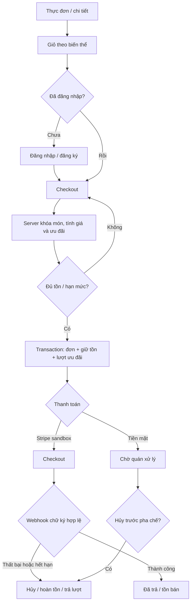
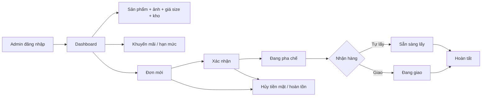

# Bản đồ dự án Nhà Cà Phê

Cập nhật: 13/10/2026. Phạm vi: cửa hàng demo localhost `:3002`, PostgreSQL `shop_cafe`, miễn phí vận chuyển, xử lý đơn ngay. Trạng thái “Đạt” là đã chạy kiểm tra tại localhost; “Chờ credentials” cần khóa do chủ dự án tự cấu hình.

## Use case

| Mã | Tác nhân | Điều kiện trước | Luồng chính | Lỗi/ngoại lệ | Kết quả |
| --- | --- | --- | --- | --- | --- |
| UC-01 | Khách | Trang mở được | Xem trang chủ, món nổi bật, danh mục | Món ngừng bán không hiển thị | Đi đến thực đơn/chi tiết |
| UC-02 | Khách | Có sản phẩm | Tìm từ khóa, lọc danh mục | Không có kết quả | Danh sách phù hợp hoặc trạng thái rỗng |
| UC-03 | Khách | Món đang bán | Xem ảnh/giá/tồn; chọn size, đá, đường nếu là đồ uống | Món nóng chỉ đá 0%; hết tồn | Biến thể được chọn; đồ ăn không có tùy chọn đồ uống |
| UC-04 | Khách | Đã chọn món | Thêm nhiều dòng, tăng/giảm/xóa trong giỏ | Giỏ trống, số lượng quá giới hạn | Giỏ lưu cục bộ theo biến thể |
| UC-05 | Khách | Email chưa tồn tại | Nhập tên, email, mật khẩu và đăng ký | Email trùng/dữ liệu sai | Tài khoản khách và phiên đăng nhập |
| UC-06 | Khách/admin | Có tài khoản | Đăng nhập mật khẩu; tùy chọn Google khi đã cấu hình | Sai mật khẩu, Google email chưa xác minh | Phiên có vai trò; route server kiểm quyền |
| UC-07 | Khách đăng nhập | Giỏ có món | Chọn giao/tự lấy, nhập liên hệ, xem giá và ưu đãi | Hết tồn/món tắt/mã sai | Báo giá từ server, chọn mức giảm cao nhất |
| UC-08 | Khách đăng nhập | UC-07 hợp lệ | Đặt trả khi nhận hoặc tại quán | Thiếu địa chỉ giao, vượt tồn, hết lượt ưu đãi | Đơn pending, giữ tồn, ghi ưu đãi và ảnh chụp giá/tùy chọn |
| UC-09 | Khách đăng nhập | Khóa Stripe test | Tạo Checkout, thanh toán bằng thẻ test, webhook xác thực | Stripe lỗi/thất bại/hết hạn/lặp | Đơn paid hoặc canceled; giữ/bán/hoàn tồn đúng trạng thái |
| UC-10 | Khách | Có đơn của mình | Xem tiến độ, món, giá và cách nhận | Không có đơn | Lịch sử đơn cá nhân |
| UC-11 | Khách/admin | Đơn tiền mặt chưa pha chế | Yêu cầu hủy | Đã pha chế/Stripe/không sở hữu đơn | Đơn canceled, hoàn tồn, trả lượt ưu đãi |
| UC-12 | Admin | Vai trò admin | Xem doanh thu, đơn, tồn, top món theo thời gian | Thiếu quyền | Dashboard `/admin` |
| UC-13 | Admin | Vai trò admin | Tạo/sửa/ẩn món, ảnh, giá size, chỉnh tồn | Giá âm/tồn âm/ảnh sai | Catalog và kho cập nhật |
| UC-14 | Admin | Vai trò admin, có đơn | Tiến trạng thái theo giao hoặc tự lấy; nhận tiền mặt lúc hoàn tất | Bỏ bước/Stripe chưa trả | Tiến độ hợp lệ, tiền và tồn cập nhật |
| UC-15 | Admin | Vai trò admin | Tạo/sửa/tắt mã hoặc ưu đãi tự động | Trùng mã, ngày sai, giá trị sai | Chương trình và hạn mức được lưu |

## Màn hình

| Mã | URL | Quyền | Thành phần chính | Trạng thái hiển thị |
| --- | --- | --- | --- | --- |
| SC-01 | `/` | Công khai | Hero, danh mục, món nổi bật | Có dữ liệu/ảnh |
| SC-02 | `/products` | Công khai | Tìm kiếm, lọc, thẻ món | Có kết quả/không có kết quả |
| SC-03 | `/products/[slug]` | Công khai | Ảnh, giá, tồn, size/đá/đường, món liên quan | Còn hàng/hết hàng/404 |
| SC-04 | `/cart` | Công khai | Dòng giỏ, số lượng, tạm tính | Giỏ có món/giỏ trống |
| SC-05 | `/login` | Công khai | Đăng nhập, tài khoản demo, Google tùy chọn | Sai mật khẩu/Google chưa cấu hình |
| SC-06 | `/register` | Công khai | Form tạo tài khoản | Hợp lệ/lỗi validation |
| SC-07 | `/checkout` | Khách | Nhận hàng, liên hệ, ưu đãi, thanh toán | Báo giá/thiếu địa chỉ/hết tồn/Stripe chưa cấu hình |
| SC-08 | `/checkout/placed`, `/checkout/success`, `/checkout/cancel` | Khách | Kết quả đặt món/Stripe | Đã ghi nhận/chờ webhook/đã rời Checkout |
| SC-09 | `/account/orders` | Khách | Danh sách, tiến độ, hủy đơn | Có đơn/trống/hủy được/không được |
| SC-10 | `/admin` | Admin | KPI, biểu đồ, top món, đơn thử | Theo 7/30/90 ngày |
| SC-11 | `/admin/products` | Admin | Sản phẩm, ảnh, giá size, tồn | Tạo/sửa/ẩn/lỗi form |
| SC-12 | `/admin/orders` | Admin | Danh sách và bước xử lý | Giao/tự lấy, thanh toán, hủy |
| SC-13 | `/admin/promotions` | Admin | Form và danh sách ưu đãi | Bật/tắt/hạn lượt/ngày |

## Liên kết triển khai

| UC | SC | API / module | Bảng chính | Triển khai | Kiểm thử |
| --- | --- | --- | --- | --- | --- |
| 01–03 | 01–03 | `catalog` Server Component/repository | `categories`, `products`, `cafe_options`, `cafe_product_details`, `inventory_movements` | Xong | Đạt: tìm Matcha ra 3 món; bánh không có tùy chọn đồ uống; không tràn ngang ở 375/768/1024/1440 px |
| 04 | 03–04 | `cart` Client Component | localStorage; quote đọc `products` | Xong | Đạt: giỏ nhiều dòng |
| 05–06 | 05–06 | `/api/auth/register`, Auth.js, `auth` | `users` | Xong | Đạt: đăng ký, đăng nhập khách/admin, phiên và chặn quyền; Google chờ credentials |
| 07 | 07 | `/api/promotions/quote`, `orders`, `promotions` | `products`, `promotions`, `promotion_redemptions` | Xong | Đạt: 5% tự động vs `CAFE10` 10% |
| 08 | 07–09 | `/api/orders`, `orders` | `orders`, `order_items`, `payments`, `inventory_movements`, `promotion_redemptions` | Xong | Đạt: tự lấy/giao, giữ tồn, giá/tùy chọn |
| 09 | 07–08 | `/api/checkout`, `/api/stripe/webhook`, `payments` | `orders`, `payments`, `stripe_events`, `inventory_movements` | Xong | Đạt: chữ ký sai, thành công, thất bại, lặp; thẻ test thực tế chờ credentials |
| 10–11 | 09 | `/api/orders/[id]/cancel`, `orders` | `orders`, `payments`, `inventory_movements`, `promotion_redemptions` | Xong | Đạt: hủy tiền mặt, hoàn tồn |
| 12 | 10 | `admin`, `lib/dashboard` | `orders`, `order_items`, `products`, `payments` | Xong | Đạt: mở bằng admin, khách không có quyền |
| 13 | 11 | `/api/admin/products/*`, `/api/admin/upload`, `admin` | `products`, `cafe_options`, `inventory_movements` | Xong | Đạt: sửa/khôi phục giá size S, tải ảnh qua API admin |
| 14 | 12 | `/api/admin/orders/[id]`, `orders` | `orders`, `payments`, `inventory_movements` | Xong | Đạt: xác nhận → pha chế → giao → hoàn tất, COD paid |
| 15 | 13 | `/api/admin/promotions/*`, `promotions` | `promotions`, `promotion_redemptions` | Xong | Đạt: tạo/tắt, hai đơn đồng thời với max 1 chỉ một đơn thành công |

## Luồng mua hàng

## Luồng quản trị

## Giới hạn và bước cấu hình

Chưa có đặt giờ, phí giao, email xác minh, đánh giá, tích điểm hay hoàn tiền Stripe tự động. Stripe sandbox thực tế và Google OAuth trực tiếp **chờ credentials** trong `.env.local`; không đưa khóa vào tài liệu hay chat. Đơn Stripe đã thanh toán muốn hủy cần admin xử lý thủ công.
