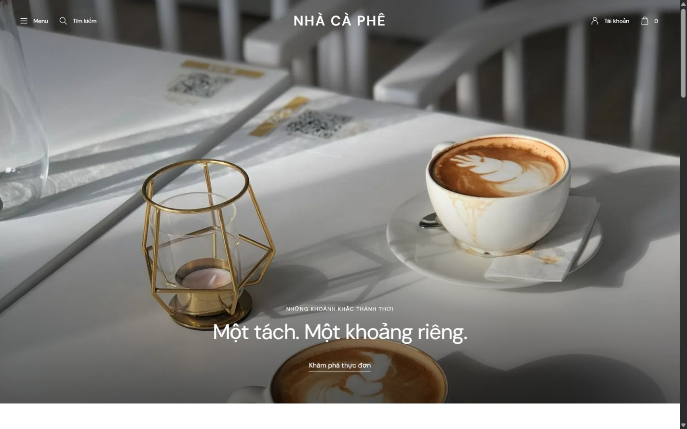

# Nhà Cà Phê

Dự án portfolio cá nhân của **nghiahnc**: website bán hàng tiếng Việt với **TypeScript, React, Next.js 16.4.1, PostgreSQL/Neon và Stripe sandbox**.

**[Mở demo](https://shop-cafe-eight.vercel.app)** · **[Mã nguồn](https://github.com/nghiahnc/shop-cafe)**



## Chức năng

- Thực đơn, tìm kiếm/lọc, chi tiết đồ uống với size/đá/đường; giỏ theo biến thể.
- Đăng ký, đăng nhập, CUSTOMER/ADMIN, lịch sử đơn riêng.
- Giao hàng hoặc tự lấy; COD và Stripe Checkout sandbox; giữ tồn, hủy/hoàn tồn.
- Mã giảm giá nhập tay và ưu đãi tự động; chọn mức giảm cao nhất đủ điều kiện.
- Quản trị món, ảnh, giá size, tồn, đơn và khuyến mãi; upload trực tiếp private storage tối đa 5 MB.
- Form demo điền sẵn. Mã mẫu: `CAFE10`, `GIAM20K`; ưu đãi còn phụ thuộc giá trị giỏ.

Giá, tài khoản và đơn là dữ liệu trình diễn. Thanh toán Stripe chỉ dùng sandbox; chưa tích hợp vận chuyển thật, thu tiền thật hoặc hoàn tiền tự động.

## Kiến trúc

**Modular Architecture**: `modules/catalog`, `cart`, `auth`, `orders`, `promotions`, `payments`, `admin` chia theo nghiệp vụ. Mỗi module có UI, service và repository; `app/` cung cấp các route Next.js. Service tính giá/ưu đãi và transaction; repository truy cập PostgreSQL. Giỏ lưu trong trình duyệt, giá và tồn được kiểm tra lại trên server. Hai đơn tranh mã giới hạn một lượt được xử lý trong transaction.

Migration SQL có phiên bản trong `db/`; tiền VND được tính lại phía máy chủ. COD chỉ ghi đã thu khi hoàn tất giao hàng. Redirect từ Stripe không tự xác nhận đã trả tiền.

## Chạy từ bản clone mới

Yêu cầu **Node.js 24**, npm và một database PostgreSQL riêng (local hoặc Neon). `package-lock.json` được giữ để `npm ci` cài đúng dependency đã khóa.

```powershell
git clone https://github.com/nghiahnc/shop-cafe.git
cd shop-cafe
npm ci
Copy-Item .env.example .env.local
```

Tạo database trống `shop_cafe` bằng tài khoản PostgreSQL của bạn, rồi sửa `DATABASE_URL` trong `.env.local` theo role/mật khẩu/host thực tế. Với Neon dùng URL pooled cho ứng dụng, URL direct cho `DATABASE_URL_UNPOOLED`, kèm SSL. Không dùng lại database của website demo công khai.

Đặt `AUTH_SECRET` thành chuỗi ngẫu nhiên riêng, có thể tạo bằng `node -e "console.log(require('crypto').randomBytes(48).toString('base64url'))"`. Sau đó:

```powershell
npm run db:migrate
npm run db:seed
npm run db:seed-demo
npm run dev
```

Mở **http://localhost:3002**. Các lệnh seed chỉ dành cho database demo của bạn; `db:seed-demo` có thể đặt lại mật khẩu fixture. Build production: `npm run build`, sau đó `npm run start`.

## Tài khoản demo công khai

| Vai trò | Email | Mật khẩu mẫu |
| --- | --- | --- |
| Khách | `demo@nhacaphe.local` | `Demo1234!` |
| Quản trị demo | `admin@nhacaphe.local` | `Admin1234!` |

Các tài khoản này được công bố có chủ đích cho bản trình diễn và hiện tại `/login`; dùng thông tin giả khi thử. Không dùng mật khẩu fixture cho hệ thống thật.

## Stripe và dịch vụ tùy chọn

COD không cần khóa Stripe. Muốn thử thẻ, tự cấu hình `STRIPE_SECRET_KEY` loại **test** và `STRIPE_WEBHOOK_SECRET`; không đưa giá trị thật vào Git. Endpoint: `POST /api/stripe/webhook`, nhận Checkout completed/expired/async payment succeeded/failed.

```powershell
stripe listen --forward-to localhost:3002/api/stripe/webhook
```

Đặt signing secret CLI cung cấp vào `.env.local`, khởi động lại app. Webhook production phải có secret riêng. Bản demo dùng Customer sandbox và Visa **4242** đã lưu, hạn **12/34**; có thể xác nhận bằng nút Pay. Không dùng thẻ thật. Khi cần nhập thẻ test thủ công dùng 4242 4242 4242 4242, hạn tương lai và CVC bất kỳ ba chữ số. Nếu Stripe không nhận VND, `DEMO_VND_PER_USD=26000` chỉ là tỷ giá minh họa.

Google OAuth chỉ bật khi có `AUTH_GOOGLE_ID` và `AUTH_GOOGLE_SECRET`; callback local là `http://localhost:3002/api/auth/callback/google`. Upload tùy chọn dùng `UPLOAD_S3_ENDPOINT`, `UPLOAD_S3_ACCESS_KEY_ID`, `UPLOAD_S3_SECRET_ACCESS_KEY`, `UPLOAD_S3_REGION`, `UPLOAD_BUCKET`. Bucket private cần CORS cho origin của bản clone; script `scripts/configure-upload-cors.mjs` dùng để cấu hình bucket của bạn. Ảnh tĩnh có sẵn không cần dịch vụ upload. 

## Kiểm tra

```powershell
npx tsc --noEmit
npm run build
# Trên database kiểm thử riêng đã migrate/seed:
npm run db:verify
# Mở app ở terminal khác trước khi chạy kiểm thử HTTP:
node tests/storefront.mjs
```

Các script nghiệp vụ có thể tạo/xóa fixture; luôn kiểm tra đang trỏ tới database thử của bạn. Báo cáo trước lần công bố GitHub: [QA Vercel](artifacts/vercel/QA.md), [QA giao diện](artifacts/homepage/QA.md). Log thô và phiên thanh toán được giữ ngoài Git.

## Triển khai và tài liệu

Vercel chạy Next.js Node.js; Neon chỉ cung cấp database/dịch vụ backend. Tạo project của bạn và đặt biến môi trường qua dashboard hoặc CLI. `npm run secrets:vercel` đọc file riêng `.env.vercel.local`; chỉ dùng khi đã link đúng project. Repo không chứa liên kết `.vercel/` của website đang chạy.

- [Nguồn ảnh và tài nguyên](ASSET_SOURCES.md)
- [Use case và sơ đồ chức năng](PROJECT_MAP.md)
- [Ảnh mobile](artifacts/homepage/mobile.jpg)

Giữ nguyên ghi công và giấy phép của ảnh, font, thư viện khi sử dụng lại.

## Adapter Cloudflare tùy chọn

Mã OpenNext/Hyperdrive vẫn được giữ trong repo; bản demo chính dùng Vercel. Bản Workers thử nghiệm trước đây chưa đạt yêu cầu CPU Free, xem [báo cáo](artifacts/cloudflare/QA.md). Không cần cấu hình Workers để chạy Node local.

`PASSWORD_SERVICE_URL` và `PASSWORD_SERVICE_SECRET` để trống khi chạy Node local (bcrypt chạy tại chỗ). Workers cần Function xử lý mật khẩu và Hyperdrive riêng; mẫu biến preview ở `.dev.vars.example`. Không chia sẻ `.dev.vars` hoặc file secret sinh ra. `neon.ts`/`wrangler.jsonc` là cấu hình tham khảo; thay ID tài nguyên bằng project của bạn trước khi triển khai.

## Giao diện editorial — 19/10/2026

Cửa hàng dùng bố cục tham khảo Louis Vuitton, với nội dung riêng của thương hiệu: ảnh chiến dịch tràn ngang, header giữa, menu/tìm kiếm/bộ lọc dạng dialog và các trang mua hàng đồng bộ. Thành phần dùng chung nằm trong `components/boutique`, CSS giới hạn trong `.boutique`; `/admin` giữ giao diện hiện có. Xem [kết quả kiểm thử và ảnh desktop/mobile](artifacts/homepage/QA.md) và [nguồn ảnh](ASSET_SOURCES.md).
